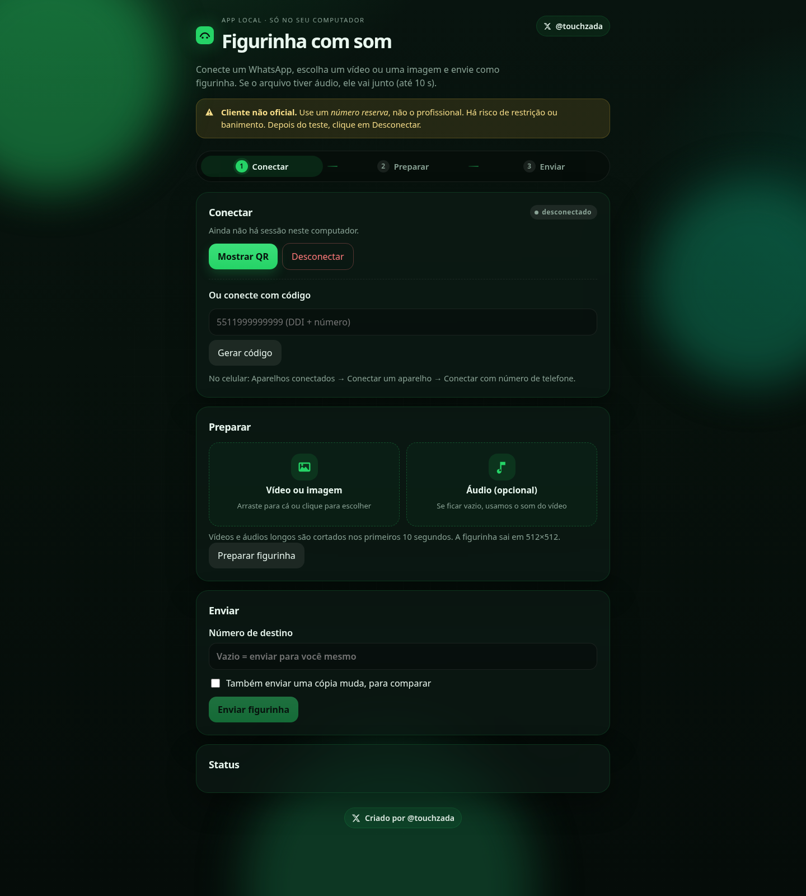
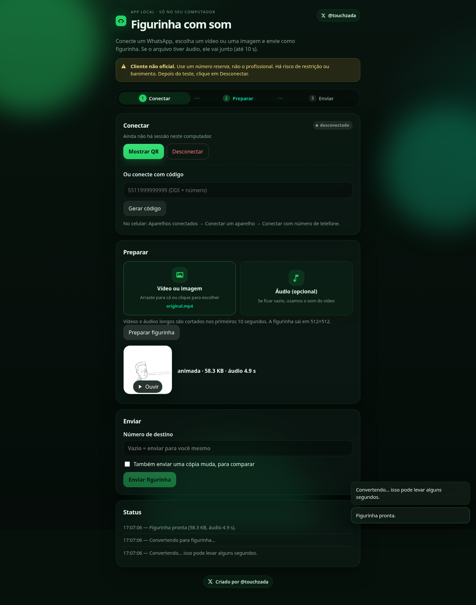
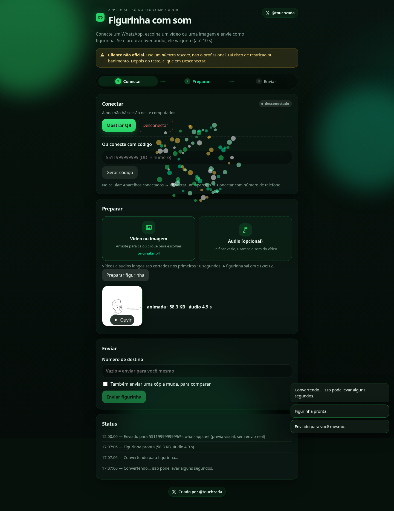

# SoundSticker

[Português](#português) · [English](#english) · [Site](https://touchzada.github.io/soundsticker/)

App local pra criar e enviar **figurinhas com som** no WhatsApp.  
Local app to create and send **WhatsApp stickers with sound**.

Criado por [@touchzada](https://x.com/touchzada) · [MIT License](LICENSE)

**Página:** <https://touchzada.github.io/soundsticker/> — entra no ar quando o GitHub Pages estiver habilitado (Settings → Pages → Deploy from branch `main` / `docs`).

**Site:** <https://touchzada.github.io/soundsticker/> — goes live once GitHub Pages is enabled (Settings → Pages → Deploy from branch `main` / `docs`).

<p align="center">
  
  
  
</p>

---

## Português

SoundSticker é um aplicativo local com interface no navegador. Você conecta o WhatsApp pelo QR ou código de emparelhamento, escolhe um vídeo ou imagem (e, se quiser, um áudio separado), e o app converte tudo no formato que o WhatsApp espera: **WebP animado 512×512 (até 500 KB)** + **OGG Opus mono (até 10 s)**. Depois é só enviar pra você mesmo ou pra outro número.

Não precisa instalar Node nem FFmpeg se você usar o pacote portátil do Windows. Pra rodar pelo código-fonte, precisa do Node 20+ e do FFmpeg (baixado automaticamente pelo script de setup).


### Aviso importante

Este app usa um **cliente não oficial** do WhatsApp (`plogme`, um fork do Baileys). Isso foge dos termos de uso da Meta.

- Pode resultar em **banimento, restrição ou desconexão** da conta.
- Use um **número reserva**. Não conecte sua conta principal, profissional ou de negócio.
- A sessão fica salva só no seu computador, na pasta `auth/`. O botão **Desconectar** apaga esses dados.
- Figurinhas com som são um recurso nativo recente do WhatsApp. A estrutura da mensagem pode mudar a qualquer momento e o envio pode deixar de funcionar.

Use por sua conta e risco.

### Requisitos

- Windows, macOS ou Linux
- Node.js 20 ou superior (não precisa no pacote portátil do Windows)
- Conexão com a internet só pra login e envio

### Como rodar a partir do código

```bash
# instala dependências (sem scripts de postinstall) e baixa o FFmpeg
npm run setup

# sobe a interface local
npm start
```

Abra [http://127.0.0.1:3847](http://127.0.0.1:3847) no navegador.

1. Conecte pelo **QR** ou pelo **código de emparelhamento** (informe o número com DDI, ex.: `5511999999999`).
2. Arraste um vídeo ou uma imagem. Se o vídeo já tiver som, ele é aproveitado. Senão, anexe um áudio.
3. Clique em **Preparar figurinha**, confira o preview e, se quiser, dê play no som.
4. Escolha o destino (o padrão é você mesmo) e envie.
5. Quando terminar, use **Desconectar** pra sair e apagar a sessão.

No Windows, depois do `npm run setup`, você também pode dar um duplo clique em `Iniciar.bat`.

### Pacote portátil no Windows

Pra gerar um `.zip` autônomo (com Node e FFmpeg embutidos), a partir de um ambiente com Node 20+:

```bash
npm run setup
npm run package-windows
```

O script `scripts/package-windows.mjs` monta a pasta em `dist-windows/` e o zip `FigurinhaComSom-Windows.zip`. No PC de destino, basta extrair e abrir `Iniciar.bat`. Não precisa instalar Node nem FFmpeg.

Publicar um release no GitHub dispara [`.github/workflows/release-windows.yml`](.github/workflows/release-windows.yml): no `windows-latest` ele roda `npm ci` e `npm run package-windows` (baixando `node.exe` e `ffmpeg.exe`) e anexa esse zip na release. O workflow não cria o release.

### Teste offline (sem conectar no WhatsApp)

```bash
npm run setup
node scripts/offline-test.mjs /caminho/do/seu-video.mp4
```

Isso só converte a mídia e monta o protobuf da figurinha. Nenhuma sessão é aberta.

### O que o app gera

| Parte | Formato |
| --- | --- |
| Figurinha | WebP 512×512, animada até 500 KB / estática até 100 KB, até 10 s |
| Áudio | OGG Opus, mono, 48 kHz, até 10 s |

O som vai embutido no campo `stickerMessage.audioMessage`. Não é o mesmo que um áudio comum nem que uma figurinha sem som.

### Desenvolvimento

```
soundsticker/
  server.mjs              servidor local (Express)
  public/                 interface (HTML, CSS, JS — sem CDN)
  lib/                    conversão (FFmpeg) e conexão WhatsApp
  scripts/fetch-ffmpeg.mjs
  scripts/package-windows.mjs
  scripts/offline-test.mjs
  Iniciar.bat
  docs/index.html         página do GitHub Pages
  docs/screens/           capturas de tela
```

A interface é tema escuro, com acentos no verde do WhatsApp, fundo em gradiente, cards em glassmorphism e suporte a `prefers-reduced-motion`. Não usa CDN externo.

---

## English

SoundSticker is a local app with a browser UI. You link WhatsApp with a QR code or a pairing code, pick a video or image (and optional separate audio), and the app converts it to what WhatsApp expects: a **512×512 animated WebP (max 500 KB)** plus **mono OGG Opus (max 10 s)**. Then you send it to yourself or to another number.

You don't need to install Node or FFmpeg if you use the portable Windows package. From source, you need Node 20+ and FFmpeg (the setup script downloads it).

### Site

The project page is <https://touchzada.github.io/soundsticker/>. It goes live once GitHub Pages is enabled: **Settings → Pages → Deploy from branch `main` / `docs`**.

### Important warning

This app uses an **unofficial WhatsApp client** (`plogme`, a Baileys fork). That is outside Meta's terms of service.

- It can get the account **banned, restricted, or disconnected**.
- Use a **spare number**. Do not connect your main, work, or business account.
- The session is stored only on your computer, in the `auth/` folder. The **Disconnect** button deletes that data.
- Stickers with sound are a recent native WhatsApp feature. The message shape can change at any time and sending may stop working.

Use at your own risk.

### Requirements

- Windows, macOS, or Linux
- Node.js 20 or later (not required for the portable Windows package)
- Internet only for login and sending

### Run from source

```bash
# install dependencies (skips postinstall scripts) and fetch FFmpeg
npm run setup

# start the local UI
npm start
```

Open [http://127.0.0.1:3847](http://127.0.0.1:3847) in your browser.

1. Connect with a **QR** code or a **pairing code** (enter the number with country code, e.g. `15551234567`).
2. Drop a video or an image. If the video already has audio, it is reused. Otherwise, attach a sound file.
3. Click **Prepare sticker**, check the preview, and optionally play the sound.
4. Pick a destination (defaults to yourself) and send.
5. When you are done, use **Disconnect** to log out and wipe the session.

On Windows, after `npm run setup`, you can also double-click `Iniciar.bat`.

### Portable Windows package

To build a self-contained `.zip` (bundled Node and FFmpeg) from a machine that already has Node 20+:

```bash
npm run setup
npm run package-windows
```

`scripts/package-windows.mjs` writes the folder under `dist-windows/` and the zip `FigurinhaComSom-Windows.zip`. On the target PC, extract it and open `Iniciar.bat`. No system Node or FFmpeg install is required.

Publishing a GitHub release runs [`.github/workflows/release-windows.yml`](.github/workflows/release-windows.yml): on `windows-latest` it runs `npm ci` and `npm run package-windows` (downloading `node.exe` and `ffmpeg.exe`) and attaches that zip to the release. The workflow does not create the release.

### Offline test (no WhatsApp connection)

```bash
npm run setup
node scripts/offline-test.mjs /path/to/your-video.mp4
```

This only converts the media and builds the sticker protobuf. No session is opened.

### Output format

| Part | Format |
| --- | --- |
| Sticker | 512×512 WebP, animated ≤ 500 KB / static ≤ 100 KB, up to 10 s |
| Audio | OGG Opus, mono, 48 kHz, up to 10 s |

The sound is embedded in `stickerMessage.audioMessage`. It is not a regular voice note, and not a silent sticker.

### Development layout

```
soundsticker/
  server.mjs              local Express server
  public/                 UI (HTML, CSS, JS — no CDN)
  lib/                    FFmpeg conversion and WhatsApp connection
  scripts/fetch-ffmpeg.mjs
  scripts/package-windows.mjs
  scripts/offline-test.mjs
  Iniciar.bat
  docs/index.html         GitHub Pages landing page
  docs/screens/           screenshots
```

The UI is a dark theme with WhatsApp-green accents, a gradient background, glassmorphism cards, and `prefers-reduced-motion` support. There are no external CDNs.

---

## Credits

Created by [@touchzada](https://x.com/touchzada).
